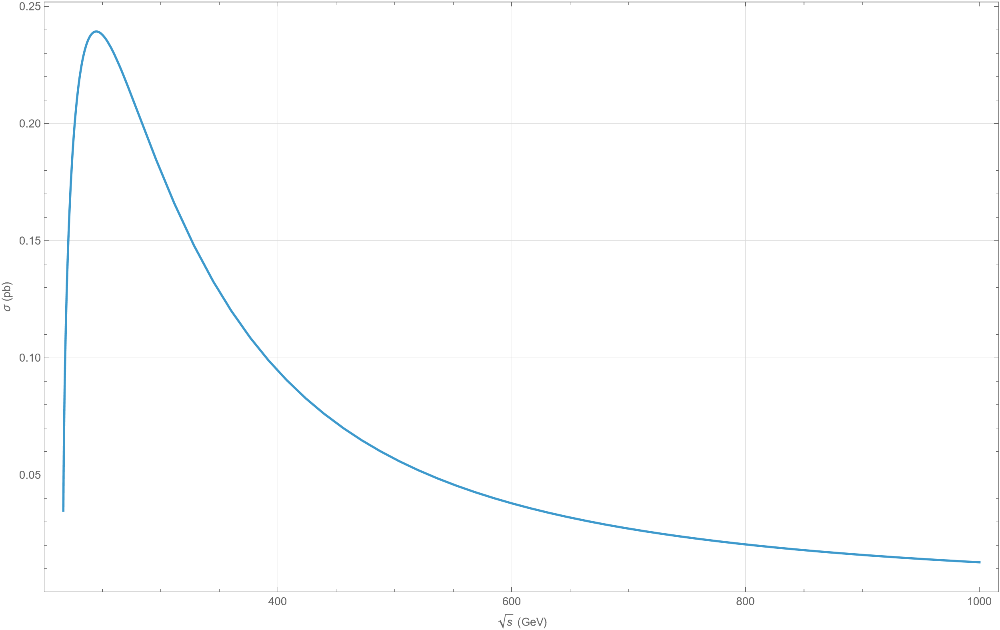
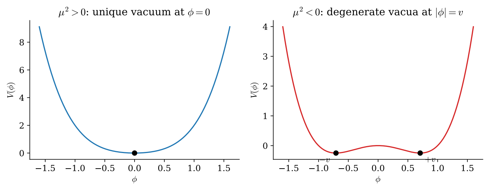
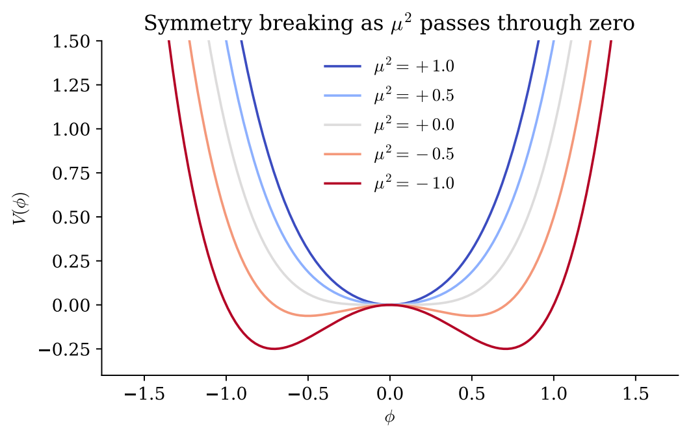
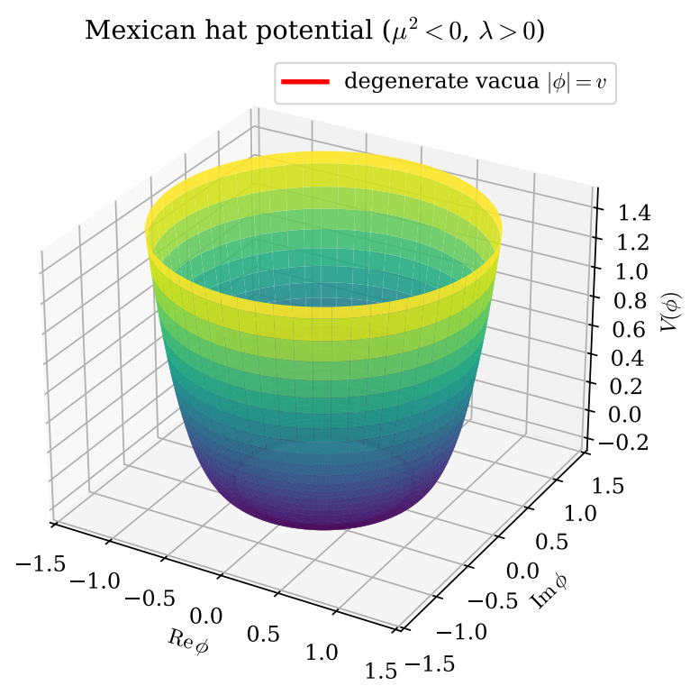
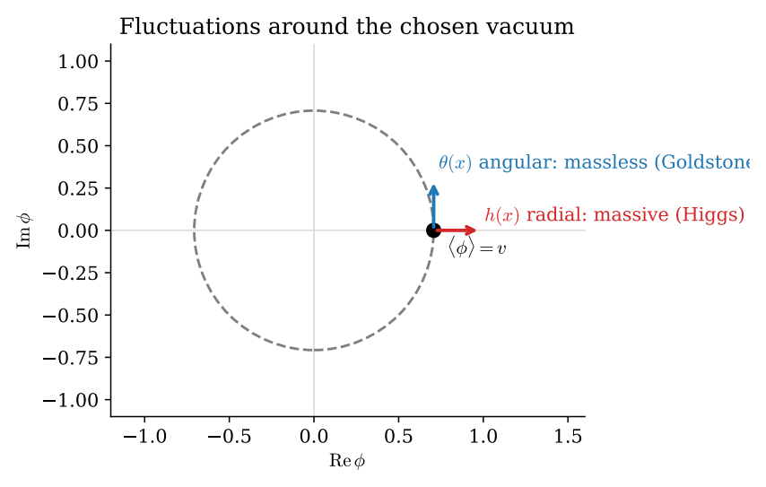
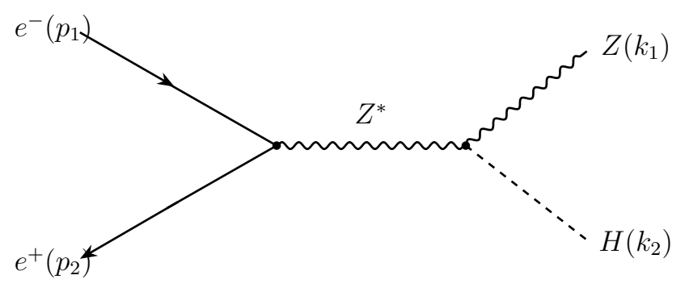
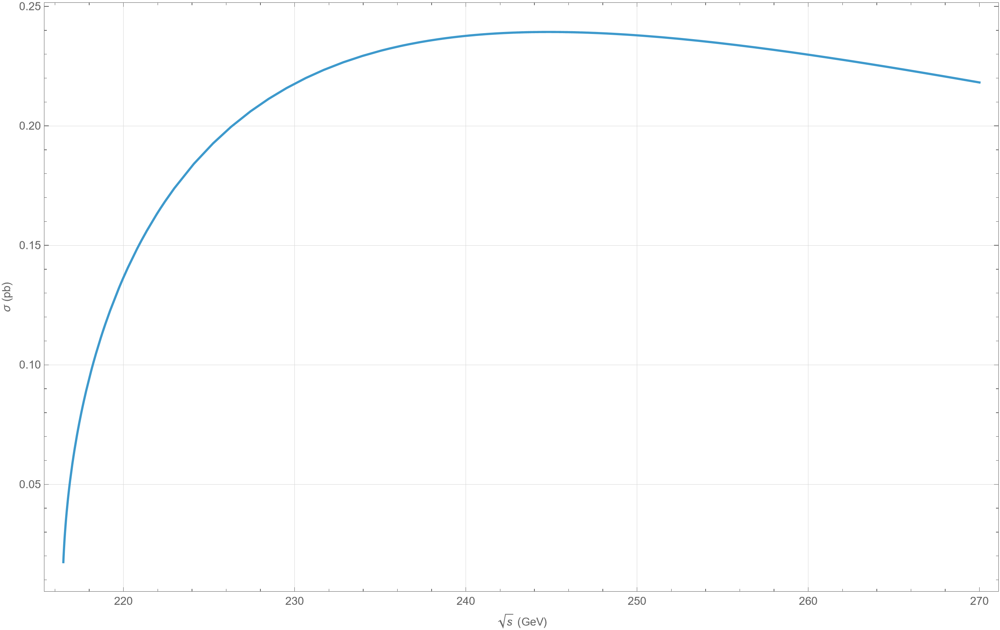
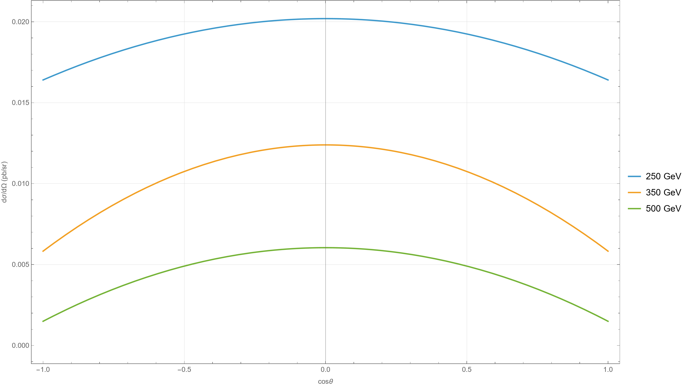

# The Higgs Mechanism and Higgsstrahlung

Sajal Farooq's internship project explores how elementary particles acquire mass and applies the electroweak Standard Model to Higgs production in electron–positron collisions.

- **Part I** develops spontaneous symmetry breaking and the Higgs mechanism. The Python script visualizes the potential and fluctuations around a chosen vacuum.
- **Part II** computes the tree-level cross section for Higgsstrahlung, e⁺e⁻ → ZH, using Mathematica and FeynCalc.

## Project files

| File | Contents |
| --- | --- |
| [Internship report](Higgs_Internship_Report.pdf) | Theory, derivations, and numerical results. |
| [Mathematica notebook](higgsstrahlung.nb) | Amplitude, spin and polarization sums, cross sections, and saved plots. |
| [Python script](make_figures.py) | Generates the Higgs potential and symmetry-breaking plots. |

## Figures

### Part I — The Higgs potential and symmetry breaking

**Potential slices**

For positive μ², the potential has one minimum at the origin. For negative μ², the slice has two degenerate minima.

**Symmetry-breaking transition**

As μ² becomes negative, the minimum at the origin splits into two minima in the one-dimensional slice.

**Mexican hat potential**

For negative μ², the minima form a circle in the complex field plane. Each point on the circle is a possible vacuum.

**Vacuum fluctuations**

Radial fluctuations climb the potential, while angular fluctuations move along the circle of degenerate minima.

### Part II — Higgsstrahlung

**Tree-level diagram**

An electron and a positron annihilate into a virtual Z boson, which produces a Z boson and a Higgs boson.

**Total cross section**

The tree-level cross section rises above the ZH production threshold, reaches a maximum, and decreases at higher energies.

**Threshold detail**

The cross section rises rapidly just above threshold as phase space opens for the ZH final state.

**Angular distribution**

The differential cross section is shown versus cos θ at three collision energies, where θ is the Z boson production angle.

## Reproduce the plots

- **Part I** — Install the Python dependencies with `python -m pip install -r requirements.txt`, then run `python python/make_figures.py` from the repository root.
- **Part II** — Open `notebooks/higgsstrahlung.nb` in Wolfram Mathematica with FeynCalc available and choose **Evaluation → Evaluate Notebook**.

## References

### Part I — The Higgs mechanism

1. F. Englert and R. Brout, “Broken Symmetry and the Mass of Gauge Vector Mesons,” *Phys. Rev. Lett.* **13**, 321 (1964).
2. P. W. Higgs, “Broken Symmetries and the Masses of Gauge Bosons,” *Phys. Rev. Lett.* **13**, 508 (1964).
3. G. S. Guralnik, C. R. Hagen, and T. W. B. Kibble, “Global Conservation Laws and Massless Particles,” *Phys. Rev. Lett.* **13**, 585 (1964).
4. S. Weinberg, “A Model of Leptons,” *Phys. Rev. Lett.* **19**, 1264 (1967).
5. ATLAS Collaboration, “Observation of a new particle in the search for the Standard Model Higgs boson with the ATLAS detector at the LHC,” *Phys. Lett. B* **716**, 1 (2012).
6. CMS Collaboration, “Observation of a new boson at a mass of 125 GeV with the CMS experiment at the LHC,” *Phys. Lett. B* **716**, 30 (2012).
7. D. Tong, [*Lectures on Quantum Field Theory*](https://www.damtp.cam.ac.uk/user/tong/qft.html), University of Cambridge.

### Part II — Higgsstrahlung and computational tools

1. J. Ellis, M. K. Gaillard, and D. V. Nanopoulos, “A phenomenological profile of the Higgs boson,” *Nucl. Phys. B* **106**, 292–340 (1976).
2. H. Baer et al., *The International Linear Collider Technical Design Report — Volume 2: Physics*, [arXiv:1306.6352](https://arxiv.org/abs/1306.6352) (2013).
3. S. Navas et al. (Particle Data Group), “Review of Particle Physics,” *Phys. Rev. D* **110**, 030001 (2024).
4. R. Mertig, M. Böhm, and A. Denner, “FeynCalc: Computer-algebraic calculation of Feynman amplitudes,” *Comput. Phys. Commun.* **64**, 345–359 (1991).
5. V. Shtabovenko, R. Mertig, and F. Orellana, “FeynCalc 10: Do multiloop integrals dream of computer codes?,” *Comput. Phys. Commun.* **306**, 109357 (2025).
6. Wolfram Research, Inc., *Mathematica*, Champaign, IL (2025).

### Textbooks

1. D. J. Griffiths, *Introduction to Elementary Particles*, 2nd revised ed., Wiley-VCH (2008).
2. M. E. Peskin and D. V. Schroeder, *An Introduction to Quantum Field Theory*, Addison-Wesley (1995).
3. F. Halzen and A. D. Martin, *Quarks and Leptons: An Introductory Course in Modern Particle Physics*, Wiley (1984).

Export the plotted outputs from Mathematica as needed. The notebook contains the total cross-section, angular distribution, and a log–log comparison.
